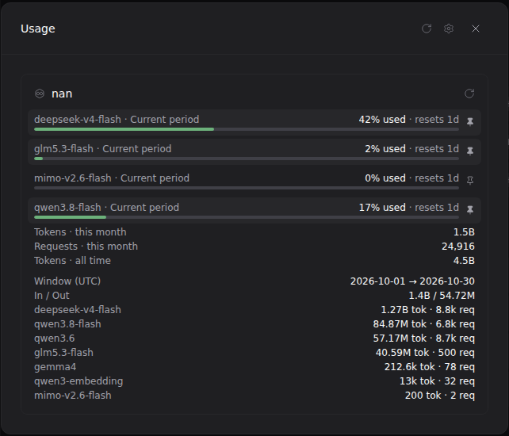

# nan usage · Paseo plugin

A [Paseo](https://github.com/getpaseo/paseo) usage-source plugin that adds a **nan**
([nan.builders](https://nan.builders)) card to the Usage modal: monthly quota rings,
month-to-date counters, lifetime tokens and a per-model breakdown — on desktop, web,
iOS and Android, on every client connected to the daemon where the plugin is installed.



*Real account data; your numbers will differ.*

## Requirements

You need all of these before installing:

- **Paseo 0.11 or newer** — usage sources don't exist on older daemons (the plugin is
  rejected with a clear error, nothing breaks; check Settings → About or `paseo --version`)
- **Plugins enabled** on the daemon you install into: Settings → Plugins → *Enable plugins*
  (one global switch; every installed plugin runs unsandboxed as your user, so install
  what you trust)
- A **nan inference API key** (`sk-…`) from [cloud.nan.builders](https://cloud.nan.builders/)
  → Settings → API Keys. Only paid inference plans (`nan_member` or GLM premium) can
  create keys, and platform tokens (`nan_pat_`) cannot read usage
- Your nan login discoverable by the plugin — in practice, either you use OpenCode with
  nan (nothing to do, we read that store) or you set `NAN_API_KEY` /
  `~/.nan/credentials.json` once; see [Where the key is read from](#where-the-key-is-read-from)

## What the card shows

- **Quota rings** — percent used this month per capped model. Rings come from nan's
  live quota data when available (including each model's own reset instant), and fall
  back to the [published catalog quotas](https://nan.builders/docs/models) otherwise:
  deepseek-v4-flash 3B · mimo-v2.6-flash 1B · qwen3.8-flash 500M · glm5.3-flash 2B
  tokens/month, plus the shared image pool (flux-2-klein + qwen-image-2.1, 100 req/month).
  Models without monthly quota (the cluster models qwen3.6 and gemma4, and glm5.3's
  billing-period allowance) intentionally show counters, never an invented percentage.
- **Balances** — tokens and API requests so far this month (UTC), plus lifetime tokens.
- **Details** — the effective window and per-model usage, e.g. `1.74M tok · 8.2k req`.

Reports are cached by the daemon for five minutes.

## Install

From a local checkout:

```bash
git clone https://github.com/adrialcaide/paseo-nan-usage && cd paseo-nan-usage
npm install && npm run typecheck     # optional, dev deps are for checking only
paseo plugin install "$(pwd)"
```

`paseo plugin add adrialcaide/paseo-nan-usage` (or paste the same into
Settings → Plugins → Plugin source). You can also paste the `owner/repo` form after
publishing to the Paseo registry.

Then open the **Usage** modal — the nan card appears next to Claude, Codex, Cursor and
the rest, already filled.

## Where the key is read from

The plugin never stores your key: what Paseo keeps is only a pointer to a store, and the
key is re-read from disk on every report refresh. Stores are tried in this order, and
all found logins group into the single nan card:

1. `NAN_API_KEY` environment variable of the daemon process
2. `~/.nan/credentials.json` or `~/.nan/config.json` — JSON with `api_key`/`apiKey`
   (or a plain-text key file)
3. **OpenCode**: the login created with `/connect` for the `nan` integration
   (OpenCode ≥ v2 stores it in its SQLite database; a v1 `auth.json` is supported too)
4. **OpenCode config**: `~/.config/opencode/opencode.json[cm]` —
   `provider.nan.options.apiKey`, the setup shown in [nan's OpenCode guide](https://nan.builders/docs/opencode).
   Parsed JSONC-style with OpenCode's `{env:VAR}` / `{file:path}` substitutions.
   Only the global config is read; project directories are never scanned.

If you prefer the plugin not to touch OpenCode's stores at all, set
`NAN_USAGE_NO_OPENCODE=1` in the daemon environment; it then uses stores 1–2 only.

## Privacy & endpoints

All requests go to two fixed HTTPS origins with `Authorization: Bearer <key>`:

| Endpoint | Purpose | Notes |
| --- | --- | --- |
| `GET https://api.nan.builders/v1/usage` | published usage API | one request per refresh, month-to-date |
| `GET https://cloud-api.nan.builders/api/usage/quota` | live quota rings | per-model allowance and reset time; if it does not answer, the plugin falls back to the published catalog quotas and keeps working |

- No telemetry, no third-party hosts, redirects are never followed.
- Credential stores are opened read-only (SQLite connections as well); the plugin never
  writes to them and never refreshes tokens — `opencode`/your CLI owns rotation.
- A custom `api_base` input (e.g. the Helmcode mirror) skips both the quota endpoint and
  quota rings, rendering raw counters only.

## Development

```bash
npm install
npm run typecheck
npm test
```

Iterating against a running daemon that already installed this folder:

```bash
paseo plugin reload nan-usage-source
paseo plugin logs nan-usage-source
```

The plugin ships no UI of its own: it is a *usage source* (`server.registerUsageSource`)
rendered by Paseo's built-in components. The icon is nan's hexagon-and-infinity mark
taken from [the official badge](https://nan.builders/badge/built-with-nan-light.svg),
stroked in `currentColor` so it follows your Paseo theme.

## License

MIT — see [LICENSE](./LICENSE).

Built against the [Paseo](https://github.com/getpaseo/paseo) plugin SDK (Apache-2.0);
the design follows Paseo's official usage-source plugins, and the icon is nan's brand
mark from [their official badge](https://nan.builders/badge/built-with-nan-light.svg).

---

<p align="center">
  <a href="https://nan.builders/?ref=built-with-nan">
    
  </a>
</p>
